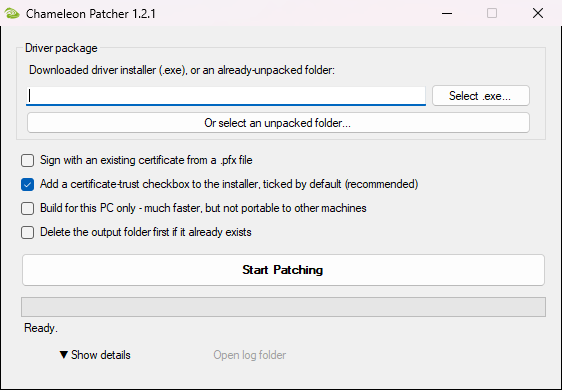
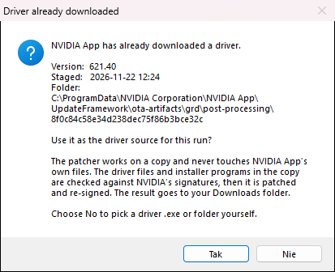

# Chameleon Patcher


Chameleon Patcher makes a stock NVIDIA driver package install and work on GPUs it does not normally
recognise - chiefly desktop PCI-E expansion cards carrying a **mobile** GPU core (laptop RTX 20-, 30-
and 40-series and RTX Ada parts). That is mobile silicon on a desktop card, a combination the stock
desktop driver's INF whitelist does not cover, so the driver will not install on such a card as-is.

Point it at a downloaded driver `.exe`. It verifies the source, unpacks, patches, checks and re-signs
it, and leaves a plain folder you install from: `<name>_Patched`.

<p align="center">
  
</p>

## Contents

- [How it works](#how-it-works)
- [Quick start](#quick-start)
- [What you need](#what-you-need)
- [Using the app](#using-the-app)
- [Command line](#command-line)
- [Installing the patched driver](#installing-the-patched-driver)
- [Supported GPUs](#supported-gpus)
- [Documentation](#documentation)
- [Safety notes](#safety-notes)
- [Contributors](#contributors)

## How it works

Two independent gates have to come off, and the patcher handles both:

- **The INF PCI ID whitelist.** 61 device/subsystem entries are added to the driver INFs - 58 to
  `Display.Driver\nv_dispi.inf` (the main desktop INF) and 3 to `nvami.inf`. All additions, no
  removals. This is what lets the driver install and the device enumerate.
- **The driver's internal Resource-Manager check.** One registry value,
  `HKR,,RM1457588,%REG_DWORD%,1`, is added to every `nv_miscBase_addreg` section. Without it a
  whitelisted GPU installs but misreports its VRAM size and has broken compute - see
  [Why VRAM size / compute needs a second fix](docs/pipeline.md#why-vram-size--compute-needs-a-second-fix).

Editing INFs invalidates NVIDIA's catalog, so the patcher rebuilds it with `Inf2Cat` and re-signs it
with a self-signed code-signing certificate minted on your machine. **A patched package therefore
installs only on a machine that trusts that certificate and has Windows Test Signing mode on** (which
requires Secure Boot to be off) - see
[Trusting the certificate](docs/signing-and-trust.md#trusting-the-certificate).

The driver binaries are not modified. The entries come from `Scripts\whitelist.json`, and the patching
is written to survive NVIDIA renumbering and renaming INFs between releases; what has actually been run
end to end is listed under [Coverage and limits](docs/pipeline.md#coverage-and-limits).

## Quick start

1. **Install the two tools** the patcher needs: 7-Zip and the Windows SDK with the WDK binaries - see
   [What you need](#what-you-need).
2. **Get the app.** Download `Chameleon-Patcher-<version>.exe` from
   [Releases](https://github.com/qron88/Chameleon_Patcher/releases) (from 1.2.1 on, each release
   carries a `.sha256` file to check the download against), or build it yourself with
   `.\Source\Build.ps1`. It is a single file and runs from anywhere.
3. **Download the NVIDIA driver** you want from nvidia.com - or let NVIDIA App download it; the
   patcher finds that copy on its own.
4. **Run the app**, pick the driver `.exe`, press **Start Patching**. A full package takes tens of
   minutes, almost all of it in the catalog rebuild; ticking *Build for this PC only* brings that down
   to a few minutes.
5. **Install** from the `<name>_Patched` folder: run its `setup.exe` and leave the *Chameleon GPU
   cert.* box ticked, with Test Signing mode on. Details:
   [Installing the patched driver](#installing-the-patched-driver).

To check first whether the GPU in this PC is one the patcher unlocks:

```powershell
.\Scripts\Invoke-DriverPatchPipeline.ps1 -CheckLocalGpuSupport
```

## What you need

Two installs; everything else ships with Windows 10/11.

| Install | What it is for | Where |
|---|---|---|
| **7-Zip** (or NanaZip - any 7z-compatible CLI) | Unpacks the driver download. Not needed when the source is an already-unpacked folder. | <https://7-zip.org/> or `winget install -e --id 7zip.7zip` |
| **Windows SDK**, with **Windows SDK Signing Tools** and **Windows Driver Kit** kept selected | `Inf2Cat.exe` (in the WDK's *Binaries* feature) rebuilds the catalog, `signtool.exe` signs it. Neither has a substitute. A full WDK development environment is **not** needed. | <https://developer.microsoft.com/en-us/windows/downloads/windows-sdk/> |

A missing tool stops the run in seconds, before anything is unpacked, and the app offers a button that
opens the download page.

- **No internet access is needed to patch.** The one network call is a best-effort RFC 3161 timestamp
  on the signature; `-SkipTimestamp` skips the attempt.
- **Already in Windows:** Windows PowerShell 5.1 (PowerShell 7 is a deliberate non-dependency), .NET
  Framework 4.x, `certutil.exe` and the PKI module.
- **To install the result:** Test Signing mode, a trusted certificate, administrator rights - and a
  driver to patch; the project bundles none.
- **To rebuild the app:** nothing extra - `Source\Build.ps1` uses the `csc.exe` that ships with the
  .NET Framework.

Where each tool is looked for, and how to point at a specific copy (`-SevenZipPath`, `-Inf2CatPath`,
`-SignToolPath`), is described under [Where the tools are looked for](docs/development.md#where-the-tools-are-looked-for) and by
`Get-Help .\Scripts\Invoke-DriverPatchPipeline.ps1 -Full`.

## Using the app

Pick a driver `.exe` (or an already-unpacked package folder) and press **Start Patching**. The app
checks the tools and the source first, then shows the current step and a progress bar; **Show
details** opens the live log. When it finishes it offers to launch the patched `setup.exe`.

| Option | Default | What it does |
|---|---|---|
| Sign with an existing certificate from a .pfx file | off | For signing with a key exported from another PC. Shows the `.pfx` and password fields. Normally leave it off: the key in your certificate store is used, and a PC without one gets a certificate minted automatically. |
| Add a certificate-trust checkbox to the installer, ticked by default (recommended) | **on** | Adds a *Chameleon GPU cert.* row to `setup.exe`'s custom options that trusts the signing certificate during install. Off: `setup.exe` changes no trust settings and you run `Approve-DriverPatchCert.ps1` yourself. |
| Build for this PC only - much faster, but not portable to other machines | off | Drops the OEM INFs that cannot match this PC, which cuts the catalog rebuild from tens of minutes to a few. See [Making a run finish in minutes](docs/pipeline.md#making-a-run-finish-in-minutes). |
| Delete the output folder first if it already exists | off | Off: an existing output folder stops the run. On: the app asks once more, then removes it. |

**If NVIDIA App has already downloaded a driver**, the app offers it when the window opens, so you can
skip the download and the unpack:

<p align="center">
  
</p>

Accepting only fills in the source; nothing runs until you press Start. The patcher works on a copy,
and the result goes to your `Downloads` folder as `NVIDIA-<version>-<hash8>_Patched`. For any other
source the result is `<name>_Patched` beside it.

Good to know:

- **A run that fails never leaves `<name>_Patched` behind.** Work happens in `<name>_Patched.partial`,
  which gets its final name only after every step has passed; the next run removes a leftover one.
- **A source that is not verifiably NVIDIA's is refused**, with a question before overriding. What is
  and is not checked: [Source verification](docs/pipeline.md#source-verification).
- **Every run writes a log** to `Logs\patch-YYYYMMDD-HHMMSS.log`; **Open log folder** takes you there.
  A failure dialog points at the log of that run.
- The standalone app keeps its scripts and signing certificates under
  `%LOCALAPPDATA%\ChameleonPatcher`.

How the app talks to the pipeline, what the log contains and how closing mid-run is handled:
[docs/gui.md](docs/gui.md).

## Command line

The app is a front end for one script, which you can run directly:

```powershell
.\Scripts\Invoke-DriverPatchPipeline.ps1 -SourceExePath "621.24-desktop-win10-win11-64bit-international-dch-whql.exe"
```

No certificate and no password are needed: the pipeline finds your existing signing key in
`Cert:\CurrentUser\My`, so every driver release keeps using the certificate you already trust.

| Switch | Effect |
|---|---|
| `-SourcePackagePath "<folder>"` | Start from an already-unpacked package instead of an `.exe`. |
| `-PruneForeignOemInfs` | Build for this PC only (the fast, non-portable build). |
| `-OutputPath "<folder>"` | Put the result somewhere other than the default. |
| `-SkipSetupCertOption` | Leave `setup.cfg` untouched; trust the certificate yourself. |
| `-SkipTimestamp` | Sign fully offline. |
| `-NonInteractive` | Never prompt; fail with a clear message instead. |

Questions the pipeline answers without patching anything:

```powershell
.\Scripts\Invoke-DriverPatchPipeline.ps1 -CheckPatchTools                        # TOOLS_OK / TOOLS_MISSING + install help
.\Scripts\Invoke-DriverPatchPipeline.ps1 -CheckLocalGpuSupport                   # SUPPORTED / UNSUPPORTED / UNKNOWN, one line per GPU
.\Scripts\Invoke-DriverPatchPipeline.ps1 -SourceExePath "<exe>" -CheckSource     # SOURCE_OK / SOURCE_UNTRUSTED
.\Scripts\Invoke-DriverPatchPipeline.ps1 -CheckNvAppStaged                       # NVAPP_STAGED (path+version) / NVAPP_NONE
```

Add `-Json` to any of them for a single line of JSON instead of the text report. Every step can also
be run as its own script; the order and the reasons for it are in
[What the pipeline does](docs/pipeline.md#what-the-pipeline-does).

## Installing the patched driver

The target machine needs two things first: **Test Signing mode on** (Secure Boot off, then
`bcdedit /set testsigning on` and a reboot) and **the signing certificate trusted**. The installer's
*Chameleon GPU cert.* box does the second for you; the other ways are in
[Trusting the certificate](docs/signing-and-trust.md#trusting-the-certificate).

Then either run `setup.exe` from the patched package root for the full NVIDIA installer, or install the
driver alone:

```powershell
pnputil /add-driver "<name>_Patched\Display.Driver\nv_dispi.inf" /install
```

Use the main display INF that is actually in that folder - its name varies by release
(`nv_dispig.inf`, `nv_dispsi.inf`).

Before installing either way, look at every catalog, not at the run's summary line:
`Sign-DriverPackage.ps1` signs the catalogs the INFs declare and **leaves the rest carrying NVIDIA's
original, now-invalidated signature** - on a pruned build that includes the catalogs of the pruned
INFs:

```powershell
Get-ChildItem "<name>_Patched\Display.Driver" -Filter *.cat | ForEach-Object {
    $s = Get-AuthenticodeSignature $_.FullName
    "{0,-24} {1,-10} {2}" -f $_.Name, $s.Status, $(if ($s.SignerCertificate) { $s.SignerCertificate.Thumbprint } else { "(unsigned)" })
}
```

Every catalog an INF in that folder references should show your thumbprint; `NotSigned` or an NVIDIA
thumbprint on a referenced catalog means the signing step did not cover it.

Only install on a machine whose GPU is one of the [supported](#supported-gpus) IDs. On a machine that
already has a supported card the added entries never match, so the driver behaves exactly as stock.

## Supported GPUs

**61 entries covering 51 PCI device IDs**, all from `Scripts\whitelist.json`:

| Generation | Entries | Examples |
|---|---|---|
| Turing - RTX 20-series | 20 | RTX 2060, 2070, 2070 Super, 2080, 2080 Super, Quadro RTX 3000 |
| Turing - GTX 16-series | 1 | GTX 1660m Ti |
| Ampere - RTX 30-series and RTX A-series mobile | 26 | RTX 3050m - 3080m Ti, RTX 2050, RTX A1000m - A5500m |
| Ada Lovelace - RTX 40-series and RTX Ada mobile | 13 | RTX 4050m - 4090m, RTX 2000 - 5000 Ada |
| Blackwell - RTX 50-series | 1 | RTX 5060m (effectively out of scope, see [limits](docs/pipeline.md#coverage-and-limits)) |

The INF matches on the PCI device and subsystem ID, not on the name, so check the exact IDs: the full
tables, with every device ID and subsystem, are in **[docs/supported-gpus.md](docs/supported-gpus.md)**.

## Documentation

- **[Supported GPUs](docs/supported-gpus.md)** - every whitelist entry by generation, and what else
  changes for those GPUs.
- **[The GUI](docs/gui.md)** - how the app runs the pipeline, the `.pfx` flow, closing mid-run, and
  what a patch log contains.
- **[How the patch pipeline works](docs/pipeline.md)** - what each step does and why.
  - [What the pipeline does](docs/pipeline.md#what-the-pipeline-does)
  - [Source verification](docs/pipeline.md#source-verification)
  - [Coverage and limits](docs/pipeline.md#coverage-and-limits)
  - [The verification gate](docs/pipeline.md#the-verification-gate)
  - [Making a run finish in minutes](docs/pipeline.md#making-a-run-finish-in-minutes)
  - [PhysX and the NVIDIA App](docs/pipeline.md#physx-and-the-nvidia-app)
  - [Why VRAM size / compute needs a second fix](docs/pipeline.md#why-vram-size--compute-needs-a-second-fix)
- **[Signing and trust](docs/signing-and-trust.md)** - how the catalog is signed, how the certificate
  becomes trusted, and how to take that trust away again.
  - [Signing](docs/signing-and-trust.md#signing)
  - [Trusting the certificate](docs/signing-and-trust.md#trusting-the-certificate)
  - [Cleaning up trusted certificates](docs/signing-and-trust.md#cleaning-up-trusted-certificates)
- **[Development](docs/development.md)** - tests, continuous integration, the project layout, and how
  versions and releases work.
- **[CHANGELOG.md](CHANGELOG.md)** - what changed in each release, and the
  [reference notes](CHANGELOG.md#reference-notes) with measurements.
- **[AGENTS.md](AGENTS.md)** - why each mechanism is the way it is; read it before reworking one.

## Safety notes

- This adds device/subsystem whitelist entries, one registry override value and the installer
  feature flags. It does not modify the driver binaries (`nvlddmkm.sys` and friends), so it cannot do
  anything to hardware that NVIDIA's driver does not already support at code level - it removes an
  INF-level gate and an internal validation gate, both already reachable in the shipped binary. The
  source must be NVIDIA-signed unless you override that explicitly.
- The signing key is created **non-exportable** and is never written as a key file, so by default
  there is no `.pfx` to leak. Be precise about what that buys: non-exportable means the key cannot be
  extracted as a portable file, not that it cannot be misused. Code running as your user can still ask
  that key to sign something, and the OS's own key-archive path can carry key material off the
  machine. If you opt into `-Exportable`, keep the `.pfx` private - anyone holding it can sign kernel
  drivers that your machine, once you trusted the cert, will accept.
- **Trusting the certificate is the part with real blast radius, not the patching.** Every entry you
  add to `Root` is a self-signed authority this machine accepts code from. Keep the number of trusted
  patch certificates at one, prune what you no longer need - see
  [Cleaning up trusted certificates](docs/signing-and-trust.md#cleaning-up-trusted-certificates) - and
  turn Test Signing mode back off when you are done.
- Applies to your own hardware; nothing here is transmitted anywhere.

## Contributors

- **qron88** - author.
- **Qwen (self-hosted LLM)** - analysis and engineering support on
  [1.0.4](CHANGELOG.md#104---2026-10-12): dependency-bar analysis, tool preflight, and the
  release-verification record.
- **Claude (Anthropic)** - security and correctness review and fixes in 1.0.6 and 1.2.1.

Licensed under the MIT license - see [LICENSE](LICENSE).
